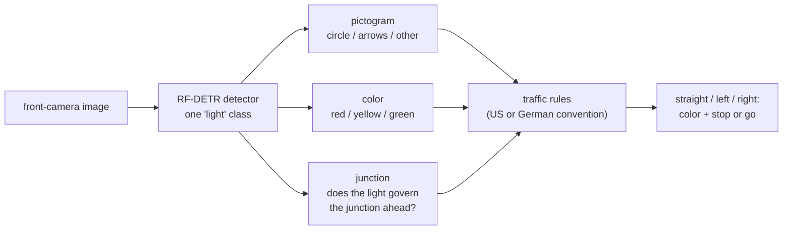

# Maneuver-level traffic signal understanding

An automated vehicle approaching a signalized junction does not need the color of every traffic light in view: it
needs to know whether **its own maneuver** (straight, left, right) may proceed. This repository predicts, from one
front-camera image, the signal color and a stop / go decision for each ego maneuver, the task introduced by Zou et
al., *One Perception, All Maneuvers* (arXiv 2609.32316).

Instead of mapping the image directly to maneuvers, a detector reads **three attributes of every traffic light**, and
**explicit traffic rules** turn them into per-maneuver signals:



- **Perception is general, rules are local.** The attributes mean the same thing in every country; the rules are
  a few lines of code (`dtsu/rules.py`). Moving to another traffic code changes the rules, not the model.
- **Datasets that each label only part of the target can be combined.** The three attribute heads are trained
  separately ("factorized"), and the loss of an attribute is switched off where a dataset does not label it. Only
  DTLD labels all three; the other datasets are added for what they bring.

## Model

The main model, **R**, is RF-DETR Medium (34 M parameters, DINOv2-S backbone) with the factorized head
(`dtsu/factorized.py`): one light-vs-background logit and three linear heads on the same decoder queries, trained
with partial labels on four datasets.

| Training source | Images | Pictogram | Junction | Color | Why it is in the mix |
|---|---|---|---|---|---|
| DTLD v2.0 (Germany) | 25,635 | ✓ | ✓ | ✓ | the only source with all three attributes |
| ATLAS (Germany) | 26,528 | ✓ | – | ✓ | more arrows, three cameras (wide / medium / tele) |
| OpenLane-V2 A + B (US, Singapore) | 14,977 | – | ✓ | ✓ | US signal heads, junction relevance from the HD-map topology |
| BDD100K (US) | 18,851 | – | – | ✓ | night scenes (72% of these frames) and horizontal lights |

Recipe: input 1280 × 1280, 5 epochs, batch 4 × gradient accumulation 4, lr 1e-4 (backbone 1.5e-4), seed 0;
pictogram and color cross-entropy weighted by n_c^-0.5; a horizontal flip that swaps left and right arrow labels;
brightness / contrast jitter; no random crop (it can cut out the light that decides a maneuver). The epoch and the
score threshold are selected on tune splits only (DTLD tune and OpenLane-V2 A / B tune); R is epoch 2 at threshold
0.35. Inference takes 29 ms per image on an RTX 5070 (bf16, batch 1).

**Traffic rules** (`dtsu/rules.py`), applied to the lights the model assigns to the junction, highest score first:
- *German convention* (DTLD): an arrow sets the color of its own maneuvers; every other maneuver, the right turn
  included, takes the circle's color.
- *US convention* (the OpenLane-V2 benchmark labels): straight takes a straight arrow or else the circle; left takes
  a left arrow or else follows straight; right is governed only by a right arrow, otherwise "none".

## Results

R at its selected epoch and threshold (`results/R.json`, tables generated by `scripts/make_tables.py`). On OpenLane-V2 the US rule is scored twice: with the lane-topology prior (maneuvers no lane of the ego approach leads to are set to "none" from the frame's HD-map lanes) and camera only. DTLD test is scored with the junction rule on the 11,494 test frames whose ground truth the rule settles.

**Per-maneuver signals** (straight, left, right). TSS = (Acc_color + Acc_pass + EM) / 3.

| Test set | Frames | TSS | Acc_color | EM | False-Go | False-Stop |
|---|---|---|---|---|---|---|
| OpenLane-V2 A val, US rule + lane-topology prior | 2,220 | 0.937 | 0.947 | 0.897 | 0.091 | 0.020 |
| OpenLane-V2 A val, US rule, camera only | 2,220 | 0.927 | 0.937 | 0.886 | 0.090 | 0.030 |
| OpenLane-V2 B val, US rule + lane-topology prior | 1,565 | 0.918 | 0.935 | 0.856 | 0.106 | 0.010 |
| OpenLane-V2 B val, US rule, camera only | 1,565 | 0.913 | 0.930 | 0.850 | 0.105 | 0.014 |
| DTLD test, junction rule (German) | 11,494 | 0.955 | 0.962 | 0.926 | 0.031 | 0.017 |

**Per-light attributes**, on the labelled lights the model detects (center matching).

| Attribute | DTLD test | ATLAS test | LISA test (out of domain) |
|---|---|---|---|
| Pictogram, macro recall | 0.812 | 0.793 | 0.590 |
| Recall of circle | 0.956 | 0.874 | 0.979 |
| Recall of arrow left | 0.860 | 0.747 | 0.265 |
| Recall of arrow right | 0.632 | 0.736 | – |
| Recall of arrow straight | 0.671 | 0.814 | 0.525 |
| Color accuracy | 0.979 | 0.986 | 0.998 |
| Yellow recall | 0.887 | 0.918 | 0.965 |
| Junction accuracy | 0.960 | – | – |

Of the 1,101 hand-labelled OpenLane-V2 val lights the model detects, 0.098 of the round ones are read as arrows. Pictogram macro recall on DTLD lamps under 20 px tall: 0.602.

**Detection** (center AP; ✱ = the training set includes this dataset's training split).

| Test set | Lights | AP | Recall | Precision | Color accuracy |
|---|---|---|---|---|---|
| ATLAS test ✱ | 6,169 | 0.814 | 0.730 | 0.902 | 0.986 |
| LISA test, day | 18,020 | 0.836 | 0.915 | 0.786 | 0.999 |
| LISA test, night | 39,629 | 0.768 | 0.783 | 0.707 | 0.998 |
| S2TLD 720p | 11,191 | 0.887 | 0.951 | 0.681 | 0.993 |
| S2TLD 1080p | 2,126 | 0.663 | 0.813 | 0.483 | 0.910 |
| S2TLD 1080p, horizontal lights | 1,031 | 0.365 | 0.768 | 0.300 | 0.875 |
| BDD100K val, day ✱ | 6,542 | 0.888 | 0.849 | 0.802 | 0.967 |
| BDD100K val, night ✱ | 10,553 | 0.848 | 0.816 | 0.761 | 0.978 |
| BDD100K val, horizontal lights ✱ | 1,680 | 0.333 | 0.680 | 0.208 | 0.944 |
| VZC-TLD | 9,812 | 0.870 | 0.694 | 0.934 | 0.939 |
| VZC-TLD, horizontal lights | 637 | 0.551 | 0.615 | 0.450 | 0.908 |

All numbers are from one training run (seed 0); the confidence intervals capture variation over test frames, not
over training runs. Full metrics, with cluster-bootstrap 95% CIs, are in [`results/`](results/).

## Ablations

**Input resolution.** The same recipe and data at 1024, 1280 (R) and 1536 px, each with its own epoch and threshold selected on the tune splits (`results/ablation_resolution/`). Latency: network only, RTX 5070, bf16, batch 1.

| Input | Selected epoch / threshold | TSS A val | TSS B val | TSS DTLD test | False-Go A / B / DTLD | DTLD pictogram macro | ... under 20 px | Latency (ms) |
|---|---|---|---|---|---|---|---|---|
| 1024 | 4 / 0.35 | 0.931 | 0.920 | 0.952 | 0.120 / 0.068 / 0.035 | 0.767 | 0.575 | 22 |
| 1280 (R) | 2 / 0.35 | 0.937 | 0.918 | 0.955 | 0.091 / 0.106 / 0.031 | 0.812 | 0.602 | 29.5 |
| 1536 | 2 / 0.35 | 0.934 | 0.936 | 0.963 | 0.107 / 0.082 / 0.028 | 0.815 | 0.579 | 54 |

R minus the other resolution, paired on the same frames / lights, with cluster-bootstrap 95% CIs:

| | ΔTSS A val | ΔTSS B val | ΔTSS DTLD test | ΔFalse-Go B val | ΔPictogram macro (DTLD) |
|---|---|---|---|---|---|
| 1280 − 1024 | +0.005 [-0.004, +0.017] | -0.002 [-0.027, +0.015] | +0.004 [-0.000, +0.008] | +0.038 [-0.006, +0.104] | +0.049 [+0.033, +0.066] |
| 1280 − 1536 | +0.003 [-0.004, +0.011] | -0.018 [-0.029, -0.008] | -0.007 [-0.011, -0.003] | +0.024 [-0.004, +0.061] | -0.010 [-0.022, +0.002] |

Going from 1024 to 1280 raises pictogram recall (mostly right and straight arrows) and lowers False-Go on A val. 1536 scores higher on B val and DTLD test than 1280 at almost twice the latency; R is the highest resolution that runs in about 30 ms.

**Training data.** `scripts/export_training_set.py --sources ...` trains the same recipe on a subset of the sources (e.g. DTLD only, + ATLAS, + OpenLane-V2, + BDD100K), to measure what each dataset contributes.

Earlier ablations at 1024 px (factorized vs. joint classes, class weights, label-swapping flip, logit adjustment) are documented in `docs/EXPERIMENT_LOG.md` (Exp 6 to Exp 9).

## Baseline M

**M** is the same RF-DETR Medium with its own detection head, trained on joint `<moves>|<color>` classes: each light
is labelled with the set of ego maneuvers it controls (from OpenLane-V2's lane topology, or from the route a DTLD lamp
serves) and its color, or as `irrelevant` (`dtsu/moves.py`). It predicts the maneuvers directly, where R reads the
pictogram and the junction and lets a fixed rule assign them; its decoder (`assign_scored`) is the benchmark's own
direction rule, so ground-truth boxes through it reproduce every label.
- Data: OpenLane-V2 A + B fit (14,977 frames) plus an equal-size random sample of D*_US fit, DTLD under the
  OpenLane-V2 protocol (`dtsu/labels_dtld.py`); 46 classes. No ATLAS, no BDD100K, no pictogram labels.
- Recipe: 1024 px, 4 epochs, lr 1e-4 / 1.5e-4, batch 4 × accumulation 4, no flip.
- Selection (Exp 5 rule): the mean of OpenLane-V2 tune TSS and D*_US tune TSS; the published run is epoch 1 at 0.25.
- Evaluated by `scripts/evaluate_moves.py`: A val and B val camera only (its native output) and with the lane-topology
  mask, DTLD test under the route labels (German rule) and D*_US test, and the perception cells of R. With
  `--reference runs/R` it pairs R and M frame by frame on the cells of the publication protocol.

`scripts/make_examples.py` draws R and M side by side on random frames in and out of distribution
(`docs/examples/`).

## Reproducing

**Environment.** Python 3.12, CUDA 13.0, one 12 GB GPU.

```bash
pip install torch==2.14.1 torchvision==0.29.1 --index-url https://download.pytorch.org/whl/cu130
pip install -r requirements.txt
python -m pytest tests
```

**Data.** The datasets are not redistributed; download them from their sources and place them as below (or point the
environment variables `DATASETS` and `OPENLANE` elsewhere).

```
datasets/
  DTLD/            DTLD v2.0: city folders with the Bayer TIFFs, v2.0/DTLD_{train,test}.json
  DTLD_jpg/        written by scripts/convert_dtld.py (needs the official dtld_parsing package)
  ATLAS_full/      ATLAS/ATLAS_classes.yaml, ATLAS/{train,test}/<camera>/{images,labels}
  BDD100K/         bdd100k_labels_release/..., bdd100k/bdd100k/images/100k/{train,val}
  LISA/            Annotations/, daySequence1/, ...           (evaluation only)
  S2TLD/           ds/{ann,img}                                (evaluation only)
  VZC_TLD/         labels/{train,test}_v1.json, img/           (evaluation only)
data/OpenLane-V2/  subset_A, subset_B: info/ and the front camera (scripts/extract_openlane_front.sh)
```

**Pipeline** (`scripts/reproduce_R.sh` runs all of it, about 16 h of training and 3 h of evaluation):

```bash
python scripts/build_labels.py                                   # maneuver labels, fit / tune splits
python scripts/export_training_set.py --out data/train_full      # COCO export with partial labels
python scripts/train.py --dataset-dir data/train_full --out-dir runs/R --resolution 1280 \
    --epochs 5 --batch-size 4 --grad-accum 4 --class-weights 0.5 --flip-swap --seed 0
python scripts/evaluate.py --run runs/R --out results/R.json     # selection + every metric
python scripts/evaluate.py --run runs/R --reference runs/R_1024 --out results/R_vs_R_1024.json
python scripts/run_video.py clip.mp4 --run runs/R --epoch 2 --threshold 0.35 --out clip_R.mp4
```

`export_training_set.py --sources dtld atlas openlane bdd` selects the training sources, for studies of the
training-data composition.

The baseline M (`build_labels.py` also writes its DTLD route labels):

```bash
python scripts/export_moves_set.py --out data/train_moves
python scripts/train.py --moves --dataset-dir data/train_moves --out-dir runs/M --resolution 1024 \
    --epochs 4 --batch-size 4 --grad-accum 4
python scripts/evaluate_moves.py --run runs/M --out results/M.json
python scripts/evaluate_moves.py --run runs/M --selection results/M.json --reference runs/R \
    --reference-selection results/R.json --no-detection --out results/R_vs_M.json
```

## Repository

| Path | Contents |
|---|---|
| `dtsu/labels.py` | maneuver labels from the OpenLane-V2 lane and traffic-element topology |
| `dtsu/rules.py` | attribute vocabulary, junction rule, US rule, DTLD ground truth |
| `dtsu/sources.py` | readers for every dataset |
| `dtsu/factorized.py` | the factorized head and its partial-label loss, class weights, the arrow-swapping flip |
| `dtsu/model.py` | loading a run and detecting |
| `dtsu/moves.py`, `dtsu/moves_evaluation.py`, `dtsu/labels_dtld.py` | the baseline M: joint classes, its decoder and evaluation, its DTLD route labels |
| `dtsu/evaluation.py`, `dtsu/stats.py`, `dtsu/metrics.py`, `dtsu/topology.py` | selection, metrics, matching, bootstraps, the lane-topology prior |
| `scripts/` | label building, export, training, evaluation, video |
| `splits/` | the fixed tune / held-out splits (OpenLane-V2 segments, DTLD and ATLAS sessions), and the DTLD frames the manual route review rejects |
| `annotations/` | blind hand labels of the pictogram of 1,172 OpenLane-V2 val lights |
| `results/` | evaluation outputs of R and of the ablations |
| `docs/EXPERIMENT_LOG.md` | the dated research log: every experiment, its design written before its results, and every deviation |

The log documents the path to R, including the experiments that did not work. The code it names is that of git tag
`pre-cleanup`; the current code reproduces its results (see the last entry of the log).

## Limitations

- **One training run per model.** Differences of about one TSS point are within what a second seed could change.
- **Map prior on OpenLane-V2.** The junction rule gives every maneuver a color whenever a junction light is seen,
  while a benchmark label is "none" for a maneuver no lane leads to. The headline OpenLane-V2 numbers therefore
  blank such maneuvers with the frame's annotated lane topology (`dtsu/topology.py`), which a camera-only system
  does not have; camera-only numbers are reported next to them.
- **"Junction" is defined differently by each source:** DTLD's route lamps plus lamps of the same size, OpenLane-V2's
  lane links. On VZC-TLD, whose relevance is narrower, the precision of the junction call is low.
- **Small lamps.** Pictograms of lamps under 15 px tall are mostly read as circles at every resolution tried.
- **Left-hand traffic is not evaluated as such:** the Singapore frames of OpenLane-V2 subset B carry US-convention
  labels, the convention that reproduces the label distribution of Zou et al.
- **Benchmark size.** The original benchmark is not public; the rebuilt OpenLane-V2 labels keep about 71% as many
  frames as Zou et al. report, so numbers are not directly comparable with theirs.

## Licenses

The code is released under the MIT license. The label files (`annotations/`, `splits/`) and any released weights are
derived from OpenLane-V2 (CC BY-NC-SA 4.0), DTLD, ATLAS and BDD100K and are for non-commercial research use under
those datasets' terms. RF-DETR is Apache-2.0.

## Citation

See [`CITATION.cff`](CITATION.cff). Please also cite Zou et al. for the task, and the datasets used:
OpenLane-V2, DTLD, ATLAS, BDD100K, LISA, S2TLD and VZC-TLD.
